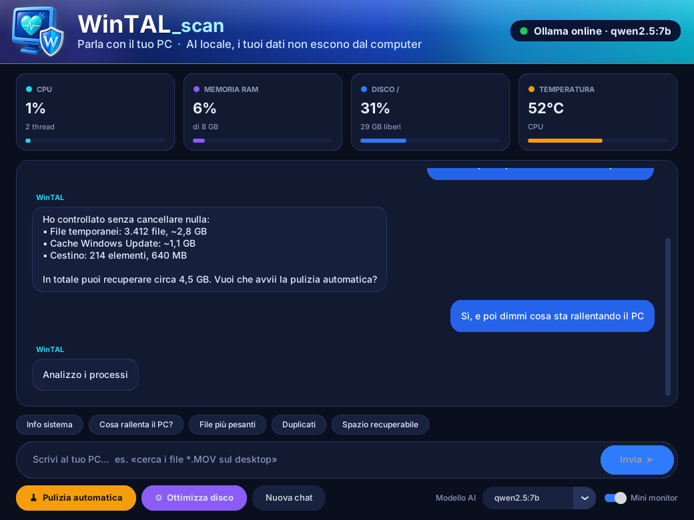
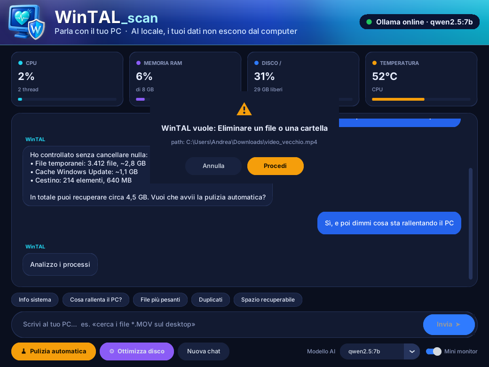
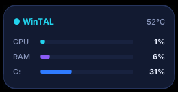

# WinTAL_scan — Parla con il tuo PC

**WinTAL_scan** è un'app per Windows che analizza e ripara il PC **chattando con lui**.
Gira con un'AI **locale** (Ollama + Qwen/Gemma/Llama): i tuoi dati non escono mai dal computer.



## Cosa puoi chiedere

- *"Dimmi tutto sul mio PC"*: sistema operativo, CPU, RAM, dischi, scheda video, temperatura
- *"Cosa sta rallentando il PC?"*: processi che usano più RAM e CPU
- *"Quali programmi partono all'avvio?"*
- *"Trovami i file più pesanti"* / *"Cerca i file \*.MOV sul desktop"*
- *"Cerca i file duplicati"*: confronta il contenuto completo e dice quanto spazio recuperi
- *"Quanto spazio posso liberare?"*: stima senza cancellare nulla
- *"Pulisci tutto"*: file temporanei, Cestino, cache di Windows Update
- *"Ottimizza il disco"*: Windows sceglie da solo TRIM (SSD) o deframmentazione (HDD)
- Rinominare, spostare ed eliminare file

## Sicurezza

- **Ogni azione che modifica il PC chiede conferma** con una finestra (Annulla / Procedi).
- Le cartelle di sistema (C:\, Windows, Program Files, cartella utente…) sono **protette**.
- I file eliminati vanno **nel Cestino**, non spariscono per sempre.
- La pulizia automatica non tocca documenti, backup o file personali.



## Interfaccia

- Tema scuro "glossy" con statistiche in tempo reale (CPU, RAM, disco, temperatura)
- Chat a fumetti, pulsanti per le domande più comuni, scelta del modello AI
- **Mini monitor** sempre in primo piano e trascinabile (doppio clic = apre WinTAL)



## Requisiti

1. **Ollama** installato e avviato: https://ollama.com
2. Un modello con supporto ai *tool*, ad esempio:
   ```
   ollama pull qwen2.5:7b
   ```
   (con poca RAM: `qwen2.5:3b` o `llama3.2:3b`)
3. **Python 3.10+** su Windows

## Avvio

```bash
pip install -r requirements.txt
python main.py
```

Per la temperatura CPU e l'ottimizzazione del disco servono i permessi di amministratore:

```bash
python avvia_come_admin.py
```

## Creare l'eseguibile (.exe)

Doppio clic su `build_exe.bat`, oppure:

```bash
pip install pyinstaller
pyinstaller --noconfirm --onefile --windowed --name WinTAL_scan --icon wintal.ico --collect-data customtkinter --add-data "logo_glossy.png;." --add-data "wintal.ico;." main.py
```

L'eseguibile sarà in `dist/WinTAL_scan.exe`. Ollama deve essere in esecuzione.

## Struttura

| File | Ruolo |
|---|---|
| `main.py` | Interfaccia grafica (customtkinter) |
| `wintal_core.py` | Tool di sistema, sensori e agente AI |
| `avvia_come_admin.py` | Avvio con permessi di amministratore |
| `build_exe.bat` | Crea l'eseguibile Windows |

Le impostazioni (modello scelto, mini monitor) sono salvate in `%APPDATA%\WinTAL_scan\config.json`.

## Limitazioni

- La temperatura CPU su Windows dipende dai sensori esposti dalla scheda madre (WMI) e spesso richiede l'avvio come amministratore.
- La qualità delle risposte dipende dal modello: i modelli da 7B in su gestiscono meglio i tool.
